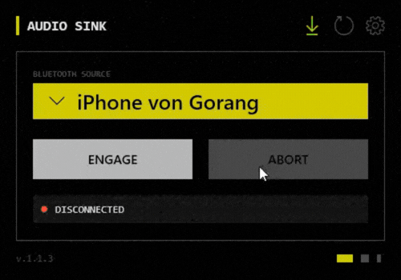

<p align="center">
  
</p>

<h1 align="center">EasyBluetoothAudio</h1>

<p align="center">
  <strong>Play your phone's audio through your PC speakers.</strong><br/>
  A free, open-source Bluetooth audio receiver for Windows 10 and 11.<br/>
  Keep playback on your phone and listen through your PC's speakers or headphones.
</p>

<p align="center">
  <a href="https://gorangn.github.io/EasyBluetoothAudio/">Explore the website — features, setup, and FAQs</a>
</p>

<p align="center">
  
  
  
  <a href="https://github.com/GorangN/EasyBluetoothAudio/releases/latest">
    
  </a>
</p>

<p align="center">
  <a href="https://github.com/GorangN/EasyBluetoothAudio/releases/latest/download/EasyBluetoothAudioSetup.exe">
    
  </a><br/>
  <sub>Free x64 installer &nbsp;·&nbsp; .NET runtime included</sub>
</p>

<p align="center">
  
</p>

---

##  Why EasyBluetoothAudio?

Keep using the music and podcast apps on your phone. EasyBluetoothAudio receives their audio over Bluetooth and plays it through your PC's speakers or headphones.

| | Benefit |
| :---: | :--- |
|  | **Keep your phone in control** — choose music, podcasts, or videos on your phone and listen through your PC |
|  | **Reconnect when the app starts** — remembers your selected phone and connects when Auto-Connect is enabled |
|  | **Keep your desktop clear** — access connection controls from the system tray while you work |
|  | **Use the Windows audio system** — receives Bluetooth audio without installing extra audio drivers |

---

##  Download & Install

**Requirements:** Windows 10 version 2004 (build 19041) or later, or Windows 11 &nbsp;·&nbsp; x64 PC &nbsp;·&nbsp; Working Bluetooth adapter

1. **[Download for Windows](https://github.com/GorangN/EasyBluetoothAudio/releases/latest/download/EasyBluetoothAudioSetup.exe)** (`EasyBluetoothAudioSetup.exe`).
2. Run the installer. The .NET 10 runtime is included.
3. Pair your phone with your PC in Windows Bluetooth settings. You only need to do this if it is not already paired.
4. Open EasyBluetoothAudio, select your phone, and click **Connect**. Start playing audio on your phone.

[Release notes and other versions](https://github.com/GorangN/EasyBluetoothAudio/releases)

> **Windows SmartScreen?** Click **More info &rarr; Run anyway**. The app is open source — you can review every line of code in this repository.

<details>
<summary>Building from Source</summary>

```bash
git clone https://github.com/GorangN/EasyBluetoothAudio.git
cd EasyBluetoothAudio
dotnet restore
dotnet build --configuration Release
```

</details>

---

##  Features

*  **Bluetooth A2DP Sink** — receives media audio from paired phones via the native Windows `AudioPlaybackConnection` API. No virtual drivers required.
*  **Smart Auto-Reconnect** — keeps trying to restore a dropped Bluetooth connection until you disconnect.
*  **System Tray Workflow** — runs silently in the background. Opens as a flyout from the notification area, just like native Windows panels.
*  **Native Device Picker** — opens the Windows Bluetooth pairing dialog directly from the app. No detour through Settings.
*  **Low-End Hardware Mode** — reduces SBC bitpool (`MaximumBitpool` / `DefaultBitpool` &rarr; 15) to stabilise audio on congested radios. UAC elevation is handled automatically.
*  **Automatic Updates** — checks GitHub Releases for new stable versions and notifies you in-app. Pre-releases are skipped.
*  **Dark & Light Themes** — Cyberpunk High-Contrast Dark (Black / Acid Yellow) and a clean Light Mode, switchable at runtime.

---

##  Settings

All preferences are persisted across sessions:

| Setting | Description |
| :--- | :--- |
| **Auto-Start** | Launch with Windows via a registry startup entry. |
| **Auto-Connect** | Reconnect to the last used device immediately on startup. |
| **Theme** | Switch between Dark (Cyberpunk) and Light mode. |
| **Toast Notifications** | Show or hide Windows toast notifications on connect / disconnect. |
| **Connection Sound** | Play an audible chime when a device connects successfully. |
| **Low-End Hardware Mode** | Reduce SBC bitpool for congested or weak radios. Requires administrator privileges. |

---

##  Technical Stack

<details>
<summary>For developers and contributors</summary>

This project is a reference implementation for modern Windows desktop development with strict Clean Architecture and MVVM.

| Component | Technology | Notes |
| :--- | :--- | :--- |
| **Framework** | .NET 10 | Latest LTS runtime |
| **UI** | WPF | Hardware-accelerated, MVVM strict — zero logic in code-behind |
| **Audio Core** | Windows.Media.Audio (WinRT) | Native `AudioPlaybackConnection` A2DP Sink |
| **Messaging** | CommunityToolkit.Mvvm 8.4.0 | Decoupled Messenger / Mediator |
| **DI** | Microsoft.Extensions.DependencyInjection | Constructor injection throughout |
| **Installer** | Inno Setup + MSIX | Standalone + packaged distribution |
| **Versioning** | MinVer | Automatic semantic versioning from Git tags |

</details>

---

<p align="center">
  <a href="https://github.com/GorangN/EasyBluetoothAudio/releases/latest/download/EasyBluetoothAudioSetup.exe">
    
  </a><br/>
  <sub>Free x64 installer &nbsp;·&nbsp; .NET runtime included</sub>
</p>
